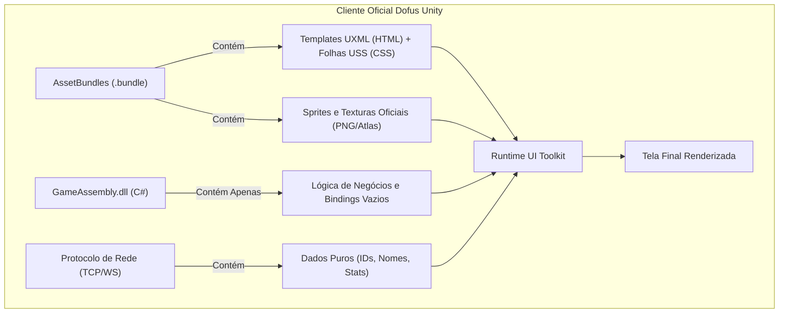
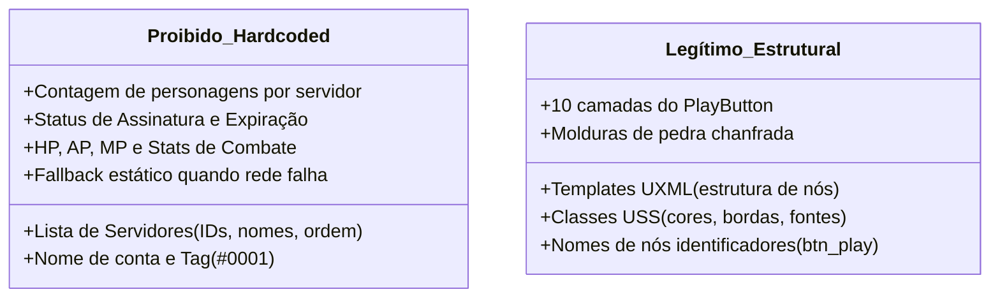
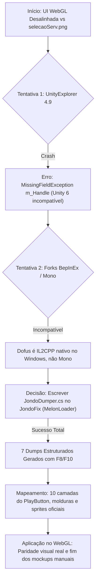
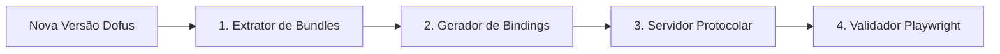

# Plano Mestre de Arquitetura, Engenharia Reversa e Automação — Dofus Unity WebClient

> **Status:** Documento de Referência Definitivo e Plano de Ataque (Revisão 2 — com Revisão Crítica)  
> **Escopo:** `Jondo.Unity.WebClient`, `Jondo.Unity.Server` e Ferramentas de Engenharia Reversa  
> **Data:** 30/10/2026 (Rev.2: 31/10/2026)  

---

## PARTE 1: FUNDAMENTAÇÃO TÉCNICA E ENGENHARIA REVERSA

Esta seção documenta o conhecimento adquirido ao longo da sessão, separando os fatos arquiteturais de hipóteses descartadas, com foco estrito no que é útil e orienta as decisões futuras do projeto.

---

### 1. Por que o GameAssembly e Core Descompilados não Traziam a UI Pronta?

Uma das maiores dúvidas em projetos de emulação/reconstrução do Dofus Unity é:  
*“Se descompilamos o `GameAssembly.dll` e o `Core.dll` e transcrevemos seu código, por que a interface não apareceu idêntica à oficial?”*

A resposta reside na separação arquitetural estrita introduzida pelo **Unity 6 (UI Toolkit / UIElements)**:



1. **A UI no Unity 6 não é código imperativo C#:**
   - O código C# do Dofus (`Core.dll`) **não cria retângulos, bordas ou botões via código**.
   - O C# apenas declara campos tipados vazios:
     ```csharp
     public Button btn_play;
     public VisualElement ctr_serverSelection;
     ```
   - Toda a geometria, hierarquia de nós, classes de estilo, sombras e texturas vivem dentro dos arquivos `.uxml` e `.uss` empacotados nos **AssetBundles** (`uielements_assets_all.bundle`).
2. **O papel da máquina de estados do Boot:**
   - O cliente oficial possui uma cadeia de 182 serviços e carregadores nativos C++ que abrem mais de 200 AssetBundles em cascata.
   - Como o nosso cliente WebGL foi construído para rodar no navegador de forma leve e rápida, nós criamos o `WebGLProbe.cs` como ponto de entrada cirúrgico.
   - No início, para fazer as telas aparecerem rapidamente, criamos elementos "na mão" (`new Button()`, cores RGB aproximadas). Isso gerou um visual de protótipo distante da referência oficial `selecaoServ.png`.
3. **A revelação prática:**
   - Transcrever o C# decompilado é reproduzir o **cérebro**;
   - Os arquivos UXML e Sprites dos bundles são o **corpo**;
   - O servidor (`Jondo.Unity.Server`) é o **combustível (dados)**.
   - Só há paridade 100% visual quando o corpo oficial (UXML + Sprites) é hidratado pelo cérebro oficial com os dados do servidor.

---

### 2. O que é "Hardcoded" vs. O que "Tem que ser assim"

Para manter a sanidade do projeto, estabelecemos a distinção formal entre o que é **vício de desenvolvimento** e o que é **arquitetura legítima de apresentação**:



#### ❌ O que É Proibido Hardcodar (Anti-padrão):
- **Listas de Servidores e Status:** Nomes, IDs (290, 291, 292), comunidades e se o jogador tem personagem ali devem vir 100% do Protobuf `AuthAccepted` e HAAPI.
- **Fallbacks Estáticos:** Códigos do tipo `if (servers == null) servers = new List<ServerInfo> { ... }` criam ilusão de funcionamento e mascaram falhas no backend. Devem ser eliminados. Se a rede não mandar dados, o cliente deve exibir o estado oficial de "Nenhum servidor disponível" (`lbl_noServer`).
- **Textos de Identidade do Jogador:** Nickname, tag, data de assinatura e contagem de personagens devem ser extraídos diretamente dos pacotes.

#### ✔️ O que TEM que ser Estrutural (Design Declarativo):
- **Hierarquia UXML e Estilos USS:** O fato de um botão ter uma camada de joia (`.button-play__jewel`), uma camada de brilho (`JewelGlow`) e uma base de metal chanfrada é a definição estética do jogo. O cliente oficial da Ankama possui isso estático em seus assets.
- **Nomes de nós (`btn_play`, `ctr_header`):** São os identificadores do contrato entre UI e código. Eles são fixos tanto no jogo oficial quanto na nossa implementação.

---

### 3. Frida vs. JondoDumper (MelonLoader): Análise Técnica Definitiva

Durante a sessão, avaliamos o uso de ferramentas dinâmicas como **Frida**, **Learn-Frida**, **il2cpp-frida** (MCP) e o **JondoDumper** (MelonLoader).

| Critério | Frida / IL2CPP-Frida (Native C++/JS Injection) | JondoDumper via MelonLoader (In-Process C#) |
|---|---|---|
| **Nível de Operação** | Fora da thread gráfica, hooks via ponte C++/JS | **Dentro da thread principal do Unity (Managed C#)** |
| **Acesso a UIElements** | Requer chamadas C da API do IL2CPP para cada propriedade | **Acesso nativo a instâncias vivas (`UIDocument`, `VisualElement`)** |
| **Estabilidade no Unity 6** | Baixa para traverse de árvores: risco de *Access Violation* por GC | **100% estável: 0 crashes em todos os dumps** |
| **Extração de Estilos Computados** | Extremamente complexo calcular `resolvedStyle` via ponte | **Instantâneo: leitura direta de dimensões e posições reais** |
| **Performance de Extração** | Segundos a minutos por dump com bridge overhead | **50 milissegundos para 1.425 nós** |
| **Veredito para UI** | Inadequado e frágil | **Teto máximo da engenharia reversa atingido** |

#### Onde o Frida AINDA é Útil no Futuro do Projeto:
- **Sniffing de Protocolo antes de TLS/Criptografia:** Se a Ankama introduzir criptografia de payload ou trocar chaves dinâmicas, o Frida é imbatível para interceptar buffers antes do empacotamento.
- **Análise de Proteções / Anti-Cheat:** Bypass de verificações de integridade em baixo nível.
- **Para a parte visual de UI:** O `JondoDumper` já entregou a totalidade dos dados necessários. Nenhuma outra ferramenta externa é necessária para a interface gráfica.

---

### 4. Retrospectiva da Sessão: Como Chegamos Aqui



1. **O impasse do UnityExplorer:** O UnityExplorer 4.9 foi desenvolvido para Unity 2019-2021. No Unity 6000.x, a Unity Technologies removeu os campos legados do canvas (`m_Handle`), provocando falha imediata ao tentar abrir sua interface.
2. **A saída técnica limpa:** Em vez de tentar adaptar um mod de 10 MB com milhares de dependências antigas, criamos um dumper enxuto de 150 linhas em C# (`JondoDumper.cs`) carregado pelo MelonLoader nativo que já estava instalado.
3. **Os dados conquistados:**
   - `Dump_210448`: Tela de Splash/Boot da Ankama.
   - `Dump_210616`: Inicialização direta via `dofus.exe` sem launcher.
   - `Dump_210706`: Menu de Configurações/Opções aberto.
   - `Dump_210746`: Janela modal de confirmação de saída (Quit).
   Esses dumps mapearam exatamente a hierarquia de 1.425 elementos, nomes de classes USS, dimensões e caminhos de assets.

---

### 5. Mudança de Postura: Superando o Ciclo Reativo "Testa, Corrige e Builda"

Reconhecemos explicitamente a armadilha do ciclo de micro-correções:
- **O ciclo vicioso:** Rodar teste -> ver 1 elemento visual deslocado -> editar 2 linhas de CSS -> disparar build de 7 minutos -> repetir.
- **O problema desse ciclo:** Desvia a atenção das decisões estruturais e de dados, gerando remendos isolados em vez de um sistema coeso.
- **A nova postura:**
  1. Planejar antes de codificar.
  2. Tratar a causa raiz (modelo de dados e contratos de binding), não apenas o sintoma visual.
  3. Compilar somente com objetivos claros e mensuráveis.
  4. Fazer do agente um parceiro sênior de engenharia que debate, documenta e executa com estratégia.

---

### 6. O "Mundo Ideal": O Pipeline de Atualização Automatizada

Para garantir que o projeto não quebre quando a Ankama lançar novas versões do Dofus (ex: 3.6.11 ou 3.7.0), o fluxo automatizado é projetado em 4 fases:



1. **Extrator de Bundles (`extract_assets.py`):** Descompacta os UXMLs, USSs e Sprites da nova pasta de assets diretamente para o projeto Unity.
2. **Gerador de Bindings (`generate_bindings.py`):** Lê o novo `dump.cs` do Il2CppDumper e gera código C# tipado para os elementos de interface.
3. **Servidor Protocolar (`Jondo.Unity.Server`):** Alimenta os dados sem depender de código cliente.
4. **Validador Playwright (`validate_parity.py`):** Valida a paridade visual por comparação de imagem (SSIM) e garante ausência de erros no console.

---

## PARTE 2: PLANO DE ATAQUE EM 3 PILARES

Este é o plano de execução passo a passo para transformar o cliente WebGL em uma aplicação 100% dinâmica, manutenível e visualmente idêntica à oficial.

```mermaid
gantt
    title Cronograma de Execução do Plano de Ataque
    dateFormat  X
    axisFormat %s
    section Pilar 1: Backend Dinâmico
    Auditoria no Jondo.Unity.Server           :p1_1, 0, 1
    Envio Completo de AuthAccepted & HAAPI   :p1_2, 1, 2
    Remoção de Mocks no WebGLProbe           :p1_3, 2, 3
    section Pilar 2: Automação de Bindings
    Parser de dump.cs e UXML                 :p2_1, 3, 4
    Gerador C# Typed Bindings               :p2_2, 4, 5
    Substituição de Queries Manuais          :p2_3, 5, 6
    section Pilar 3: Validação Visual
    Inspeção da Tela de Servidores          :p3_1, 6, 7
    Inspeção do Mapa 3D & HUD               :p3_2, 7, 8
    Consolidação E2E e Fechamento           :p3_3, 8, 9
```



---

### PILAR 1: Focar no Backend e Dados Dinâmicos (`Jondo.Unity.Server`)

**Objetivo:** Eliminar qualquer dependência de dados mockados no cliente WebGL. O cliente passa a ser um mero consumidor reativo das mensagens do servidor.

#### Tarefas Detalhadas:
1. **Auditoria de Mensagens no `Jondo.Unity.Server`:**
   - Arquivo alvo: `Jondo.Unity.Server/Network/ConnectionProtocol.cs` e `GameServerProxy.cs`.
   - Garantir que o pacote Protobuf `AuthAccepted` (campo `f2f3f1`) contenha:
     - Lista dos 14 servidores oficiais (IDs, nomes, status de população, comunidade).
     - Lista de servidores do jogador ordenada: servidores com personagens devem vir no topo (ex: `Tal Kasha` com ID 290 no centro do carrossel).
     - Contagem real de personagens por servidor (`f4.f1[].f3`).
     - Nickname da conta e tag (`f2` e `f3`) vindo de `DatabaseManager`.
     - Timestamp de expiração de assinatura real (`f5`).
2. **Desacoplamento no `WebGLProbe.cs`:**
   - Remover completamente o bloco de mock:
     ```csharp
     // REMOVER DEFINITIVAMENTE:
     // servers = new List<ServerInfo> { new ServerInfo { id = 292 ... } };
     ```
   - Vincular a lista `_serverList` diretamente ao evento do socket.
   - Se `_serverList` for vazia ou nula, exibir o elemento oficial `lbl_noServer` ("Ningún servidor disponible"), sem tentar "inventar" servidores.
   - Vincular `lbl_title` e badges de personagem estritamente aos dados recebidos.

---

### PILAR 2: Construir o Script de Automação de Bindings (`generate_bindings.py`)

**Objetivo:** Eliminar a digitação manual de `root.Q("btn_play")` e manipulações imperativas de nós no C#. O código C# passa a ser gerado automaticamente a partir dos UXMLs e do `dump.cs`.

#### Tarefas Detalhadas:
1. **Desenvolvimento do Script `Tools/generate_bindings.py`:**
   - **Entrada:**
     - Arquivos `.uxml` em `Assets/UI/` (extraídos dos bundles oficiais).
     - Arquivo `dump.cs` gerado pelo Il2CppDumper a partir do `GameAssembly.dll`.
   - **Processamento:**
     - Extrai todos os nós que possuem atributo `name="..."` no UXML.
     - Localiza as classes de binding originais da Ankama em `Core.UI.Bindings` (ex: `ServerSelectionBinding`, `CharacterSelectionBinding`, `PlayButtonBinding`).
     - Gera uma classe C# fortemente tipada:
       ```csharp
       // Arquivo gerado automaticamente por generate_bindings.py - Não editar manualmente
       namespace Jondo.UI.Generated {
           public class GeneratedServerSelectionBinding {
               public VisualElement Root { get; private set; }
               public VisualElement ctr_serverSelection { get; private set; }
               public Button btn_play { get; private set; }
               public Label lbl_title { get; private set; }
               public VisualElement ctr_carouselMode { get; private set; }
               
               public void Bind(VisualElement root) {
                   Root = root;
                   ctr_serverSelection = root.Q("ctr_serverSelection");
                   btn_play = root.Q<Button>("btn_play");
                   lbl_title = root.Q<Label>("lbl_title");
                   ctr_carouselMode = root.Q("ctr_carouselMode");
               }
           }
       }
       ```
2. **Integração no Cliente WebGL:**
   - O `WebGLProbe.cs` instancia o UXML oficial e chama `binding.Bind(root)`.
   - Eventos de clique são vinculados aos campos tipados (`binding.btn_play.clicked += ...`), eliminando qualquer risco de `NullReferenceException` silenciosa por erro de digitação de string.

---

### PILAR 3: Verificar e Consolidar o Resultado Visual

**Objetivo:** Validar a conformidade estética final com a referência `selecaoServ.png` e os dumps oficiais, sem afobação e sob controle do usuário.

#### Tarefas Detalhadas:
1. **Inspeção da Tela de Seleção de Servidores (`02_server_selection.png`):**
   - Confirmar a visibilidade do botão JUGAR (`btn_play`) de 10 camadas na posição `bottom: 44px`.
   - Confirmar a checkbox `cb_onlyCharacter` ("Mostrar solo mis personajes") ao lado do botão.
   - Validar a presença das molduras chanfradas de pedra (`slideCornerBgHeader` e `BorderBgHeader`) no topo.
   - Confirmar a ordem dinâmica do carrossel (`Tylezia` à esquerda, `Tal Kasha` selecionado ao centro com miniatura, `Hell Mina` à direita).
2. **Inspeção do Mundo 3D e HUD em Jogo (`04_world_map_hud.png`):**
   - Confirmar o mapa 3D renderizado upright (sem inversão vertical e sem sobreposição de background de nebulosa).
   - Validar a montagem dos 4 cantos do HUD oficial:
     - Topo Esquerdo: `CharacterInformation`
     - Topo Direito: `BannerMenu`
     - Base Esquerda: `ChatView`
     - Base Direita: `ActionBar`
3. **Consolidação do Relatório Final:**
   - Salvar as capturas de tela finais no diretório de artefatos.
   - Registrar as métricas de performance e estabilidade (0 erros no console do navegador).

---

## CRITÉRIOS DE SUCESSO

| Item | Critério de Aceite | Validação |
|---|---|---|
| **Backend Dinâmico** | Zero mocks de servidores no C#; dados 100% vindos do Protobuf `AuthAccepted` | Console logs do WebSocket |
| **Bindings Automáticos** | Classes geradas automaticamente por script a partir do UXML e `dump.cs` | Script `generate_bindings.py` funcional |
| **Paridade Visual** | Botão JUGAR de 10 camadas visível; molduras chanfradas; carrossel ordenado | Playwright E2E Screenshot |
| **Mundo 3D & HUD** | Mapa 3D visível upright com as 4 janelas do HUD ativas | Playwright E2E Screenshot |
| **Zero Regressão** | Zero exceções JavaScript no console durante todo o fluxo (Login -> Mapa) | Teste Playwright completo |

---

## PARTE 3: REVISÃO CRÍTICA — O QUE FALTAVA NO PLANO ORIGINAL

Após auditoria linha a linha no código-fonte (`WebGLProbe.cs`, `ConnectionProtocol.cs`, `GameServerProxy.cs`, `DatabaseManager.cs` e `dump.cs`), identifiquei **7 lacunas concretas** que o plano original não cobria. Cada uma, se ignorada, causaria bugs silenciosos ou retrabalho futuro.

---

### Lacuna 1: Tag e Assinatura NÃO SÃO Parseados do Protobuf (Pilar 1)

> [!CAUTION]
> O campo `f3` (tag da conta) e o campo `f5` (data de expiração de assinatura) **são enviados pelo servidor** no Protobuf `AuthAccepted`, mas o parsing do cliente (`WebGLProbe.cs` linha 4369) só extrai o `f2` (nickname). Os campos `f3` e `f5` são simplesmente ignorados.

**Evidência no código:**
```csharp
// Linha 4369 — ÚNICO campo extraído do f2f3f1:
string nickname = f2f3f1 != null ? PbStr(f2f3f1, 2) : null;
// f3 (tag) → NÃO parseado
// f5 (subscription) → NÃO parseado
```

**Consequência:** O cabeçalho do jogador (`MountCharacterHeader`) usa textos fixos:
- `lbl_tag` → `"#0001"` hardcoded (linhas 2736–2740)
- `lbl_subscription` → `"Hasta el 15/10/2027, 13:11"` hardcoded (linhas 2746–2750)
- `_accountNickname` → fallback `"admin"` na declaração (linha 61)

**Correção necessária:** Adicionar ao bloco de parsing do `AuthAccepted`:
```csharp
string accountTag  = f2f3f1 != null ? PbStr(f2f3f1, 3) : null;
string subEndDate  = f2f3f1 != null ? PbStr(f2f3f1, 5) : null;
if (!string.IsNullOrEmpty(accountTag))  _accountTag = accountTag;
if (!string.IsNullOrEmpty(subEndDate))  _subscriptionEndDate = subEndDate;
```
E no `MountCharacterHeader`, substituir os textos fixos por `_accountTag` e `_subscriptionEndDate`.

---

### Lacuna 2: Lógica de Reordenação do Carrossel Hardcoded a IDs Específicos (Pilar 1)

> [!WARNING]
> No bloco `else` (quando `_serverList` vem do Protobuf, linhas 3229–3267), a lógica de reordenação **busca servidores por IDs fixos**:
> - `id == 292` → forçado como "esquerda" (linha 3250)  
> - `id == 291` → forçado como "direita" (linha 3257)

**Por que é problema:** Se amanhã a Ankama adicionar novos servidores ou mudar IDs, essa lógica quebra silenciosamente. O cliente oficial **não** faz reordenação por IDs fixos — ele coloca no centro o primeiro servidor onde o jogador tem personagens e distribui os vizinhos da mesma categoria nos lados.

**Correção necessária:** A reordenação deve ser genérica:
1. Centro = primeiro servidor com `charCount > 0` (ou o servidor default se nenhum tiver personagens).
2. Esquerda = vizinho anterior na lista ordenada por tipo.
3. Direita = vizinho seguinte na lista ordenada por tipo.
4. IDs específicos (290, 291, 292) nunca devem aparecer no código de layout.

---

### Lacuna 3: Fallback de Server ID 290 na Ação "Enter" (Pilar 1)

> [!WARNING]
> Na linha 6882, quando o jogador aperta Enter na tela de servidores sem ter selecionado nenhum, o código tem um fallback fixo:
> ```csharp
> int servId = _pendingServerId > 0 ? _pendingServerId 
>     : (_serverList != null && _serverList.Count > 0 ? _serverList[0].id : 290);
> //                                                                        ^^^
> ```
> O `290` (Tal Kasha) é um ID hardcoded que só funciona se esse servidor existir no banco. Se o backend tiver outro servidor default, isso falha silenciosamente.

**Correção:** Remover o fallback `290` e usar apenas `_serverList[0].id` se houver servidores. Se a lista for vazia, não permitir ação de "enter" nessa tela.

---

### Lacuna 4: `lbl_noServer` É Escondido Incondicionalmente (Pilar 1)

> [!NOTE]
> Na linha 2983, o código **sempre** esconde o `lbl_noServer`:
> ```csharp
> root.Query<Label>("lbl_noServer").ForEach(l => {
>     l.style.display = DisplayStyle.None;
>     l.style.visibility = Visibility.Hidden;
>     l.text = "";
>     l.visible = false;
> });
> ```
> Isso significa que mesmo se a lista de servidores vier vazia do backend, o label nunca será mostrado ao jogador. O plano dizia "exibir o estado oficial `lbl_noServer`", mas o código atual impede isso.

**Correção:** Mover a ocultação de `lbl_noServer` para **depois** de verificar se `_serverList.Count > 0`. Se for zero, **mostrar** o label com o texto oficial em vez de escondê-lo.

---

### Lacuna 5: Mapeamento de Tipos Ankama → Unity no Gerador de Bindings (Pilar 2)

> [!IMPORTANT]
> O `dump.cs` usa tipos proprietários da Ankama que **não existem** no nosso projeto Unity WebGL:
> 
> | Tipo no dump.cs | Tipo equivalente no Unity standard |
> |---|---|
> | `DofusVisualElement` | `VisualElement` |
> | `DofusLabel` | `Label` |
> | `DofusButtonCustom` | `Button` |
> | `DofusIcon` | `VisualElement` |
> | `PlayButton` | `VisualElement` (ou `Button`) |
> | `ServerCard` | `VisualElement` |
> | `CheckboxCustom` | `Toggle` |
> | `DofusTab` | `VisualElement` |
> | `TextInput` | `TextField` |
> | `TableColumnHeader` | `VisualElement` |
> | `DofusToggleButtonCustom` | `Toggle` |
> | `DropdownButton` | `VisualElement` |
> | `EntityDisplayer` | `VisualElement` |
> 
> O script `generate_bindings.py` **precisa de uma tabela de mapeamento** para traduzir esses tipos do dump para tipos do Unity standard, senão o código gerado não vai compilar.

**Correção necessária no Pilar 2:** Incluir um dicionário de mapeamento de tipos no script, com possibilidade de estender conforme novos tipos apareçam em versões futuras do Dofus.

---

### Lacuna 6: O Gerador de Bindings Deve Cobrir Todas as Telas, Não Só 2 (Pilar 2)

> [!NOTE]
> O plano original mencionava apenas `ServerSelectionBinding` e `CharacterSelectionBinding`. Mas a auditoria no `dump.cs` revelou que existem **7 structs de binding** que o cliente WebGL carrega atualmente:
> 
> | Struct no dump.cs | Tela/Componente |
> |---|---|
> | `LoginBinding` (L195777) | Tela de Login |
> | `ServerSelectionBinding` (L206570) | Seleção de Servidores |
> | `CharacterSelectionBinding` (L172087) | Seleção de Personagem |
> | `CharacterHeaderBinding` (L171372) | Cabeçalho com nickname/tag/assinatura |
> | `ActionBarBinding` (L161970) | Barra de Ação no HUD |
> | `BannerMenuBinding` (L166910) | Menu de Bandeira no HUD |
> | `CharacterInformationsBinding` (L171454) | Info do Personagem no HUD |
> | `ChatviewBinding` (L172682) | Chat no HUD |
> 
> Todas essas precisam ter seus bindings gerados automaticamente para eliminar completamente as queries manuais do `WebGLProbe.cs`.

---

### Lacuna 7: Ausência de Testes Unitários para o Gerador de Bindings (Pilar 2)

> [!TIP]
> O plano prevê testes E2E com Playwright (Pilar 3), mas **não prevê testes unitários** para o `generate_bindings.py` em si. Se o formato do `dump.cs` mudar sutilmente entre versões do Il2CppDumper (ex: espaçamento, ordem dos campos, nomes obfuscados), o parser pode gerar código incorreto sem que ninguém perceba até o build Unity falhar.

**Recomendação:** Criar um arquivo `test_generate_bindings.py` com:
- Snippet de dump.cs de teste (mock da struct `ServerSelectionBinding`).
- Asserção de que o C# gerado contém os campos esperados com os tipos corretos.
- Asserção de que tipos Ankama são mapeados para tipos Unity.

---

## RESUMO DAS LACUNAS E IMPACTO NO PLANO

| # | Lacuna | Pilar Afetado | Severidade | Ação |
|---|---|---|---|---|
| 1 | Tag (`f3`) e Assinatura (`f5`) não parseados do Protobuf | Pilar 1 | **Alta** | Adicionar parsing + propagar para `MountCharacterHeader` |
| 2 | Reordenação do carrossel presa a IDs fixos (292, 291) | Pilar 1 | **Média** | Substituir por lógica genérica: centro = servidor com personagem |
| 3 | Fallback `290` na ação Enter | Pilar 1 | **Média** | Remover fallback; bloquear Enter se lista vazia |
| 4 | `lbl_noServer` escondido incondicionalmente | Pilar 1 | **Média** | Condicionar à contagem real de servidores |
| 5 | Falta de tabela de mapeamento Ankama → Unity para tipos | Pilar 2 | **Alta** | Criar dicionário de mapeamento no `generate_bindings.py` |
| 6 | Gerador cobre só 2 de 8 telas | Pilar 2 | **Média** | Expandir para todas as 8 structs de binding identificadas |
| 7 | Sem testes unitários para o gerador | Pilar 2 | **Baixa** | Criar `test_generate_bindings.py` com snippets mock |
